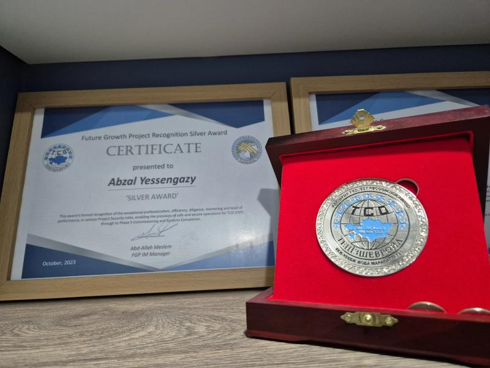
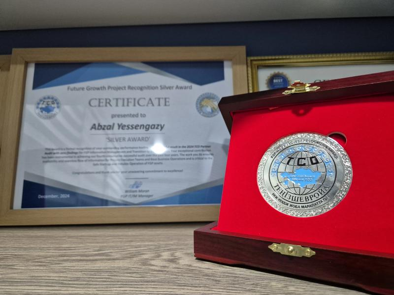

# Abzal Yessengazy

**Analytics Engineering · BI · AI-assisted data delivery**

Atyrau, Kazakhstan (UTC+5) · Remote
abzal.yessengazy@gmail.com · [LinkedIn](https://www.linkedin.com/in/abzal-yessengazy/)

---

## Summary

I build and govern the data layer decisions run on — and increasingly, the AI that reviews it.

12+ years in enterprise data. Currently Senior BI Analyst at EPAM Systems, building an internal BI platform from scratch on Google BigQuery: dbt models and documentation, metric definitions and governance, and AI-assisted review workflows. Previously eleven years at Chevron (Tengizchevroil), owning asset data at scale — 1.5M+ equipment tags, 60M+ data points, accuracy raised to 99%.

MSc Operational Research with Data Science, University of Edinburgh (Bolashak scholar). Microsoft PL-300.

---

## Experience

### Senior Business Intelligence Analyst
**EPAM Systems** · May 2025 – Present · Remote

*Current engagement — internal BI platform for an AI-powered communication-training product (Google BigQuery, Azure Log Analytics):*

- Build and document dbt models on BigQuery, enriching model descriptions for AI/agent ingestion and publishing to dbt docs.
- Audit production dashboards and data sources end to end — SQL logic, filter bindings, exclusions, caveats — identifying a multi-week event-ingestion gap and tracing dashboard anomalies to root cause.
- Peer-review analyst-built data sources for correctness, privacy (masking, small-cell suppression) and consistency with documented metric definitions, giving clear actionable feedback to authors.
- Design AI-assisted review workflows using MCP-connected agents (GitHub Copilot in VS Code) and a reusable, evidence-based review prompt that standardises findings, severity and author feedback.
- Design a structured metric-definitions registry — scope, canonical SQL, allowed variants, owners, verification status — as the basis for automated checking of new data sources against approved definitions.
- Work in VS Code with Git, GitHub pull requests and code review; Jira and Confluence (Rovo AI) for delivery.

*Earlier engagements — enterprise BI and Power Platform delivery:*

- Owned the full lifecycle of enterprise Power BI reports used by 100+ stakeholders across multiple regions: licensing and workspace setup, semantic modelling, advanced DAX, row-level security and stakeholder handover.
- Delivered a Tableau-to-Looker migration — remodelled the underlying data and rebuilt report logic in LookML.
- Designed and built responsive Power Apps Canvas applications: UI/UX, Power Fx logic, Dataverse backend and automated workflows.
- Integrated Power BI with Dataverse, SharePoint, Jira, SonarQube and Azure DevOps; automated data ingestion with Python and Power Query.
- Acted as technical SME during discovery: requirements gathering, client demos and user acceptance testing.
- Produced user guides, technical documentation and knowledge-transfer sessions.

**Stack:** dbt · BigQuery · Power BI (DAX, Power Query) · Looker/LookML · Power Apps · Dataverse · Python · Azure DevOps · Jira · REST APIs

---

### Data Analytics Team Lead — Information Management Group
**Chevron (Tengizchevroil), Kazakhstan** · Jul 2024 – Apr 2025

- Coordinated a team of data analysts and document controllers delivering engineering asset data and documentation for a major EPC programme.
- Oversaw delivery and assurance across 1.5M+ equipment tags and 60M+ data points.
- Implemented data management and validation frameworks, raising asset data accuracy to 99%.
- Developed strategic plans for timely, budget-compliant data delivery.
- Built Power BI dashboards and SQL analytics tools improving transparency of engineering and asset data.
- Coordinated data delivery workflows between engineering teams, project stakeholders and data management units.

### Data Coordinator — Information Management Group
**Chevron (Tengizchevroil), Kazakhstan** · Nov 2020 – Jul 2024

- Designed and maintained ETL pipelines using SQL Server, SSIS, Azure Data Factory and PowerShell.
- Integrated and reconciled data from enterprise source systems — JD Edwards EnterpriseOne (ERP), SAP Ariba and Capstone Reliability — into governed data models.
- Developed validation and quality-control processes across source-to-target mappings: null propagation, deduplication, hierarchical rollups.
- Maintained master data, taxonomy and asset hierarchies across engineering disciplines and enterprise systems.
- Built Power BI reports supporting critical decision-making; trained teams on data processes and documented workflows.

### Intern Data Scientist
**ExPretio Technologies, Montreal, Canada (Remote)** · Jun 2020 – Sep 2020

- Developed a machine-learning approach to railway passenger demand forecasting for a revenue-optimisation consultancy.
- Proposed a Multi-Task Learning model using deep neural networks (TensorFlow / Keras); achieved 100% client acceptance.
- Evaluated against two state-of-the-art models and outperformed them in 5 of 12 cases, with a low error rate.

### Data Analyst — Operational Excellence Group
**Chevron (Tengizchevroil), Kazakhstan** · Sep 2015 – Aug 2019

- Built an incident and events log-book with automated statistics, trend analysis and extraction features.
- Tracked and forecast usage data for a large-scale Oil & Gas project.
- Coordinated collection and development of monthly KPIs; produced weekly and monthly management reports.
- Prepared and presented written analysis in English and Russian.

### Reporting Specialist — HSE Department
**Chevron (Tengizchevroil), Kazakhstan** · Aug 2013 – Sep 2015

- Analysed and reported HSE data — incident reports, safety audits, compliance metrics — for stakeholders and regulatory audits.
- Developed dashboards providing actionable insight to improve safety performance and mitigate risk.

---

## Projects

| Project | What it does | Stack |
|---|---|---|
| **timaltravel_bot** | Production Telegram bot that runs a structured intake conversation, answers user enquiries automatically and writes qualified records to Google Sheets | Claude API · Node.js · Google Sheets API · Render |
| **BI platform (personal build)** | Lean working analytics platform — governed data sources, models, dashboards — designed and AI-coded end to end | BigQuery · dbt · VS Code |

> Repos are being cleaned up and published — links land here as they go public.

---

## Technical Skills

- **Analytics engineering** — dbt (models, documentation, dbt docs), BigQuery SQL, LookML, dimensional modelling, metric definitions & governance
- **BI & visualisation** — Power BI (semantic modelling, DAX, Power Query, RLS, workspace architecture), Looker, Tableau
- **AI & LLM** — prompt engineering, agentic workflows and MCP, Claude and OpenAI APIs, GitHub Copilot, Rovo AI
- **Data platforms & ETL** — Google BigQuery, Azure Data Factory, SSIS, SQL Server, Oracle, Azure Log Analytics, REST API integration
- **Languages** — SQL, Python, R, DAX, M (Power Query), PowerShell
- **Power Platform** — Power Apps (Canvas, Power Fx), Power Automate, Dataverse
- **Machine learning** — TensorFlow, Keras, forecasting, applied statistics
- **Tooling** — VS Code, Git, GitHub (pull requests, code review), Azure DevOps, Jira, Confluence, Render

---

## Education

**MSc Operational Research with Data Science** — The University of Edinburgh, UK · 2019 – 2020
Graduated with Merit · Bolashak scholarship holder
Advanced coursework in statistics, analytics and machine learning; R, SQL, Python.

**BSc Automation and Controls (Engineering)** — L.N. Gumilyov Eurasian National University, Kazakhstan · 2009 – 2013
Graduated with Merit

---

## Certifications

Microsoft Power BI Data Analyst (PL-300) · Anthropic Claude Architect · IBM Data Science Methodology · Python for Applied Data Science (IBM)

---

## Teaching

Delivered a two-day lecture on Data Visualisation and Dashboard Design to 76 students for **Tech Orda**, a government technology-education initiative, alongside a colleague at EPAM Kazakhstan.

---

## Recognitions

Recognised for outstanding contributions to the Chevron Kazakhstan Information Management Group. Recipient of **two Silver Medals** for excellence in data analytics and project delivery.

  
  

---

## Languages

English (C1) · Russian (second native) · Kazakh (native) · Turkish (B2)

---

## Recommendations

- **Craig Ginnett** — Crisis & Emergency Management Professional
- **Abduvakhit Junussov** — Data Analyst
- **Botagoz Mukatova** — Data Scientist

---

## Portfolio

**BI Report Demo — Hackathon Dashboard**

<video controls width="800">
  <source src="Power BI Dashboard for Hackathon.mp4" type="video/mp4">
  
Your browser does not support HTML5 video. <a href="Power BI Dashboard for Hackathon.mp4">Download the video</a>.

</video>

**Download CV** — [CV - Abzal Yessengazy.docx](CV%20-%20Abzal%20Yessengazy.docx)
